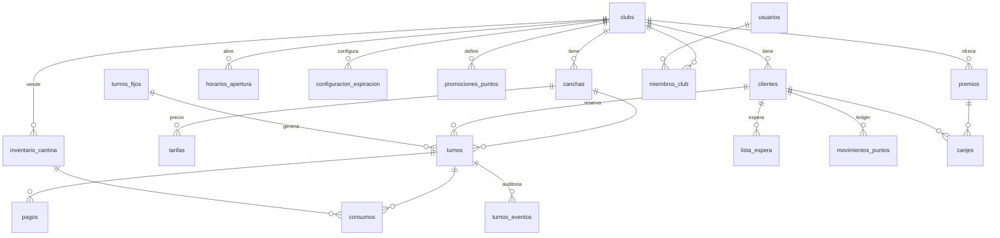
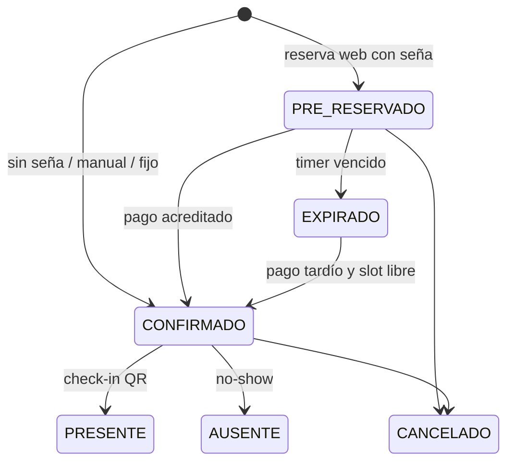

# Canchería — Arquitectura base

> Esquema completo: [`packages/db/migrations/0001_init.sql`](../packages/db/migrations/0001_init.sql) · Pruebas: [`packages/db/test/concurrencia.test.ts`](../packages/db/test/concurrencia.test.ts)

## 1. Stack tecnológico

| Capa | Elección | Por qué |
|---|---|---|
| Lenguaje | **TypeScript** end-to-end | Un solo lenguaje; los esquemas Zod se comparten entre front y API (mismas validaciones en ambos lados). |
| Frontend | **Next.js 15** (App Router) + **Tailwind** + **shadcn/ui** + **TanStack Query** | SSR para la página pública `/{slug}` (carga rápida en 4G y vista previa al compartir por WhatsApp). El panel admin es una PWA instalable en la tablet de recepción. |
| API | **Fastify 5** sobre Node 22 | Uno de los frameworks HTTP más rápidos de Node, con validación por esquema y bajo overhead. Para este dominio la concurrencia la resuelve Postgres, no los hilos de la app; por eso Go o Rust no aportan una ventaja real acá. |
| ORM / SQL | **Drizzle ORM** | SQL-first, sin binario ni motor aparte. Permite SQL crudo tipado para lo que importa (`EXCLUDE`, `FOR UPDATE SKIP LOCKED`, rangos). |
| Base de datos | **PostgreSQL 16** | Tipos de rango + *exclusion constraints*: la anti-sobrerreserva queda garantizada por el motor. También transacciones ACID, `LISTEN/NOTIFY` y JSONB. |
| Jobs / cron | **Worker propio sobre tablas de Postgres** (`FOR UPDATE SKIP LOCKED` + *lease*) | Expiración de holds, outbox de notificaciones, reembolsos. Cambio respecto de la propuesta original (pg-boss): ver §5. |
| Tiempo real | `LISTEN/NOTIFY` → API → **SSE** | El trigger de `turnos` emite un evento solo si la transacción hace COMMIT; el navegador refresca la grilla. Si después se escala a muchas instancias, se cambia por Redis pub/sub sin tocar el front. |
| Pagos | **Mercado Pago Checkout Pro** + webhooks | Transferencias: comprobante subido a **Cloudflare R2** (S3) y revisado por el admin. |
| Notificaciones | **WhatsApp Cloud API** (Meta, mensajes con plantilla); SMS de respaldo (Twilio) | Despachadas desde una tabla *outbox* con reintentos. |
| QR | `qrcode` (generación) · `BarcodeDetector` / `@zxing/browser` (escaneo con la cámara) | |
| Auth admin | **Better Auth** (sesiones con cookie httpOnly, roles por club) | Los clientes no tienen cuenta. |
| Infra | Docker · API + worker en Fly.io/Railway · web en Vercel · Postgres gestionado (Neon/Supabase/RDS) | Logs con pino + Sentry + OpenTelemetry. |

### Estructura del monorepo (pnpm + Turborepo)

```
apps/
  web/        Next.js — público (/[slug]) + admin (/admin)
  api/        Fastify — REST + SSE + webhooks
  worker/     tareas periódicas: expiraciones, conciliación con MP, reembolsos, outbox
packages/
  db/         migraciones SQL (fuente de verdad) + esquema Drizzle tipado, migrador, seed
  core/       dominio puro: reglas de precio, seña, expiración, puntos (testeable sin DB)
  shared/     esquemas Zod + tipos compartidos front/back
```

Dentro de `api/` se organiza por **módulo de dominio** (`reservas/`, `canchas/`, `pagos/`, `checkin/`, `fidelizacion/`, `cantina/`, `reportes/`), cada uno con `routes → service → repository`.

## 2. Modelo de datos



Decisiones clave:

- **Multi-tenant por `club_id`** en cada tabla. Las FK compuestas `(club_id, cancha_id)` y `(club_id, cliente_id)` impiden que un turno mezcle una cancha de un club con un cliente de otro. Más adelante se puede sumar Row-Level Security.
- **`turnos.rango`** es una columna `tstzrange` generada a partir de `inicio`/`fin` (`[)`, así 20–21 y 21–22 no chocan).
- **Importes congelados** en el turno (`precio_total`, `monto_sena`) y en los consumos (`precio_unitario`): si cambia la tarifa, las reservas ya hechas no se alteran.
- **Puntos como ledger** (`movimientos_puntos`, solo inserciones). `clientes.saldo_puntos` es una caché con `CHECK >= 0`. Un índice único parcial garantiza que un partido acumule puntos una sola vez.
- **Outbox** (`notificaciones`): se escribe en la misma transacción que el cambio de negocio, así nunca se avisa de algo que hizo rollback ni se pierde un aviso.
- **`codigo_checkin`** de 128 bits aleatorios (no el id). El QR contiene la URL del comprobante (`https://…/r/{codigo}`). No hace falta firmarlo con HMAC (como proponía la primera versión de este documento): adivinar un código de 128 bits es inviable, y el check-in además verifica que la reserva sea del club de quien escanea, esté confirmada y sea para ese horario.

### Máquina de estados del turno



Estados que **ocupan** la cancha: `PRE_RESERVADO`, `CONFIRMADO`, `PRESENTE`, `AUSENTE`.

## 3. Control de concurrencia

### Capa 1 — La base de datos es la que decide (garantía dura)

```sql
CONSTRAINT turnos_sin_solapamiento EXCLUDE USING gist (
  cancha_id WITH =,
  rango     WITH &&
) WHERE (estado IN ('PRE_RESERVADO','CONFIRMADO','PRESENTE','AUSENTE'))
```

Postgres valida la constraint de forma atómica con el índice: si dos transacciones insertan turnos solapados en la misma cancha en el mismo milisegundo, la segunda espera a que termine la primera y, si esta hace COMMIT, falla con `23P01`. No hay ventana de carrera, no hace falta ningún lock en la app, y se cumple aunque haya N instancias de la API, un bug en el código o un `INSERT` manual.

**Verificado:** `packages/db/test/concurrencia.test.ts` lanza 50 transacciones simultáneas por el mismo horario → **1 éxito, 49 rechazos por `turnos_sin_solapamiento`**, y un solo turno vivo.

> ¿Por qué no un "SELECT para ver si está libre y después INSERT"? Porque entre el SELECT y el INSERT otra transacción puede colarse (*check-then-act*). Con `SELECT … FOR UPDATE` sobre la fila de la cancha también funciona (lock pesimista), pero serializa todas las reservas de esa cancha. La exclusion constraint solo hace esperar a quien realmente compite por el mismo rango.

### Capa 2 — Transacción corta de reserva

```ts
// apps/api/src/reservas/reservas.service.ts (esqueleto)
async function crearReserva(input: CrearReservaInput) {
  const cfg   = await resolverConfigExpiracion(input);   // §4
  const precio = await resolverTarifa(input);
  try {
    return await db.transaction(async (tx) => {
      await tx.execute(sql`SET LOCAL app.actor = 'cliente'`);
      const cliente = await upsertCliente(tx, input.cliente);   // por teléfono/DNI
      // expiración perezosa: libera holds vencidos que pisan el rango pedido
      await tx.execute(sql`
        UPDATE turnos SET estado = 'EXPIRADO', expira_en = NULL
         WHERE cancha_id = ${input.canchaId} AND estado = 'PRE_RESERVADO'
           AND expira_en <= now() AND rango && tstzrange(${input.inicio}, ${input.fin}, '[)')`);
      return await tx.insert(turnos).values({
        ..., estado: cfg.requiereSena ? 'PRE_RESERVADO' : 'CONFIRMADO',
        expiraEn: cfg.requiereSena ? calcularExpiracion(cfg, input.inicio) : null,
        idempotencyKey: input.idempotencyKey,
      }).returning();
    });
  } catch (e) {
    if (pgCode(e) === '23P01') throw new ConflictError('TURNO_OCUPADO');      // → HTTP 409 + horarios alternativos
    if (pgCode(e) === '23505' && esIdempotencia(e)) return buscarPorIdempotencyKey(input);
    throw e;
  }
}
```

La creación de la preferencia de Mercado Pago (llamada HTTP externa) va **después** del COMMIT, nunca dentro de la transacción.

### Capa 3 — Idempotencia

- **Reservas:** el front genera un `idempotency_key` (UUID) por intento. Un doble clic o un reintento de red devuelve la misma reserva (índice único parcial).
- **Webhooks:** `UNIQUE (proveedor, external_id)` en `pagos` hace que la misma notificación de MP no pueda procesarse dos veces.

### Capa 4 — Bloqueo optimista para ediciones del admin

Mover un turno de horario o editarlo: `UPDATE turnos … WHERE id = $1 AND version = $2`. Si afecta 0 filas, otro recepcionista lo modificó y la UI recarga. El trigger incrementa `version` en cada UPDATE.

### Capa 5 — Contadores sin carreras

```sql
UPDATE inventario_cantina SET stock = stock - $n WHERE id = $1 AND stock >= $n;        -- 0 filas = sin stock
UPDATE clientes SET saldo_puntos = saldo_puntos - $c WHERE id = $1 AND saldo_puntos >= $c; -- canje
```

### Lock pesimista solo donde hay "leer y decidir"

El webhook de pago y el check-in hacen `SELECT … FROM turnos WHERE id = $1 FOR UPDATE` antes de transicionar el estado, así un pago y una expiración simultáneos sobre el mismo turno se serializan.

## 4. Timer de expiración de seña

### 4.1 Resolución de la regla

Para un turno (cancha, día, hora de inicio) se buscan las filas activas de `configuracion_expiracion` que matchean (los campos `NULL` actúan como comodín) y se elige con:

```sql
ORDER BY prioridad DESC,
         (cancha_id IS NOT NULL) DESC,
         (dia_semana IS NOT NULL) DESC,
         (hora_desde IS NOT NULL) DESC
LIMIT 1
```

Ejemplo de configuración de un club:

| nombre | día | franja | requiere_sena | seña | minutos |
|---|---|---|---|---|---|
| General | — | — | ✅ | 50 % | 30 |
| Finde | sáb/dom | — | ✅ | 50 % | 10 |
| Siesta sin seña | lun–vie | 13–17 | ❌ | — | — |

La lógica vive en `packages/core` como función pura (`resolverRegla(reglas, turno)`), con tests unitarios. Las reglas del club se cachean en memoria unos segundos.

### 4.2 Cálculo de `expira_en`

```
expira_en = min(now() + minutos_expiracion, inicio_turno - margen_min_antes_inicio)
```

Si el resultado es menor a ~3 minutos desde ahora (turno inminente), la política configurable es: (a) exigir el pago inmediato con un timer mínimo de 3–5 min, o (b) no permitir reservar online ese turno y mostrar "llamá al club".

### 4.3 Tres capas para que un hold vencido nunca bloquee la cancha

1. **Lectura:** la consulta de disponibilidad considera libre un `PRE_RESERVADO` con `expira_en <= now()`. El público ve el turno libre en el mismo segundo en que vence, aunque el worker todavía no haya pasado.
2. **Escritura (expiración perezosa):** la transacción de reserva pasa a `EXPIRADO` los holds vencidos que pisan el rango antes de insertar (ver capa 2). Si dos personas compiten por ese hold vencido, el lock de fila del UPDATE las serializa y la exclusion constraint deja ganar solo a una. *Verificado en el test.*
3. **Worker:** un barrido cada 30 s:

   ```sql
   WITH vencidos AS (
     SELECT id FROM turnos
      WHERE estado = 'PRE_RESERVADO' AND expira_en <= now()
      ORDER BY expira_en LIMIT 500
      FOR UPDATE SKIP LOCKED          -- varias instancias del worker sin pisarse
   )
   UPDATE turnos t SET estado = 'EXPIRADO', expira_en = NULL
     FROM vencidos v WHERE t.id = v.id
   RETURNING t.id, t.club_id, t.cancha_id, t.inicio, t.fin;
   ```

   El worker se encarga de los **efectos secundarios**: avisar al cliente ("tu reserva venció"), cerrar el checkout impago, ofrecer el turno a la lista de espera y emitir el evento de tiempo real. Las capas 1 y 2 hacen que la corrección **no dependa** de que el worker sea puntual. La expiración perezosa de la capa 2 registra los mismos efectos (`registrarExpiraciones`), así el aviso al cliente sale aunque el hold lo haya liberado una reserva nueva.

   **Conciliación antes de expirar:** si el hold tiene un checkout de MP abierto, el worker primero le pregunta a MP (`/v1/payments/search?external_reference=<turno>`) si hubo un pago. Esto cubre webhooks demorados o perdidos, y también un eventual error en la validación de la firma.

### 4.4 Pagos y el timer

Implementado en `packages/servicios/src/pagos.ts`.

- **Preferencia de Mercado Pago:**
  - `external_reference = turno.id` y `expiration_date_to = expira_en`: MP no acepta pagos fuera de término.
  - `binary_mode: true`: el pago se aprueba o se rechaza en el momento, sin estados "pendiente" que se resuelvan horas después.
  - Sin efectivo ni cajeros (`excluded_payment_types: ticket, atm`), porque se acreditan tarde.
  - Una sola preferencia abierta por turno (índice `pagos_sena_abierta_uq`) y `X-Idempotency-Key`.
  - Si MP no responde, la API devuelve `502 MP_SIN_RESPUESTA` y sugiere transferencia.
- **Webhook** (`POST /webhooks/mercadopago/:slug`, una URL por club porque cada club cobra en su propia cuenta de MP):
  1. Se valida `x-signature` (HMAC-SHA256 de `id:…;request-id:…;ts:…;` con la clave secreta del club).
  2. Nunca se confía en el cuerpo: se consulta `GET /v1/payments/{id}` con el token del club.
  3. En una transacción, primero se bloquea el turno (`FOR UPDATE`) y después los pagos. **Siempre en ese orden** (webhook, conciliación y aprobación de transferencias), para no generar deadlocks.
  4. Se registra el pago de forma idempotente: el mismo pago procesado N veces produce el efecto una vez. *Verificado con 10 webhooks simultáneos.*
  5. Si fue aprobado:
     - `PRE_RESERVADO` → `CONFIRMADO`;
     - `EXPIRADO` → se intenta revivir dentro de un SAVEPOINT; si da `23P01` (otro tomó el horario) → reembolso `PAGO_TARDIO`;
     - seña ya pagada → reembolso `PAGO_DUPLICADO`;
     - monto menor a la seña → reembolso `MONTO_INSUFICIENTE`.
- **Reembolsos:** se registran en `reembolsos` dentro de la misma transacción (un pago se devuelve una sola vez, `pago_id UNIQUE`). El worker los ejecuta contra MP con el id del reembolso como clave de idempotencia, con backoff exponencial, y quedan `FALLIDO` para revisión manual a los 8 intentos. Los de transferencia quedan registrados para devolverlos a mano.
- **Transferencia:** el comprobante (JPG/PNG/WEBP/PDF ≤ 5 MB, validado por su contenido) deja el pago `EN_REVISION` y extiende `expira_en` en `clubs.minutos_revision_transferencia` (60 por defecto), sin pasar del inicio del turno. Aprobarlo sigue el mismo camino que un pago de MP. Si se rechaza, se avisa el motivo y el cliente puede subir otro.

### 4.5 Lista de espera al liberarse un turno

Cuando un turno pasa a `EXPIRADO` (y, con el panel de admin, a `CANCELADO`), el worker busca la primera inscripción `ACTIVA` compatible: FIFO por `creado_en`, franja que contenga el turno completo, misma cancha o mismo tipo, sin clientes bloqueados y sin incluir a quien dejó vencer el turno. Para esa persona crea un **hold `PRE_RESERVADO` propio** (queda en `lista_espera.oferta_turno_id`) con el timer de la regla del horario y le manda por WhatsApp el link. Como el hold ocupa la cancha, nadie del público se la "roba" mientras la persona de la lista decide.

- **Si paga** la inscripción queda `CONVERTIDA`; **si vence** queda `VENCIDA` y el turno se le ofrece al siguiente.
- **Horario sin seña:** la oferta igual se tiene que aceptar (`POST /public/reservas/:codigo/confirmar`), con un timer de 30 min.
- **Turno inminente:** si ya no hay tiempo de ofrecerlo (menos de 3 min antes del margen previo al inicio), queda libre al público.

## 5. Worker (`apps/worker`)

Cada tarea corre cada N segundos, contados desde que terminó la corrida anterior, así que nunca se solapa consigo misma. Pueden correr varias instancias del worker, porque todas reclaman trabajo con `FOR UPDATE SKIP LOCKED`. Ante SIGTERM se espera a que terminen las corridas en curso.

**Por qué no pg-boss (cambio respecto de la propuesta original):** todo el trabajo pendiente ya vive en tablas de negocio con su estado (`turnos.expira_en`, `notificaciones`, `reembolsos`). Una cola aparte duplicaría ese estado y abriría la posibilidad de que se desincronicen (un job encolado para algo que ya cambió). Barrer las tablas con `SKIP LOCKED` es igual de durable, se prueba con SQL común y no agrega un esquema ni una dependencia. Si aparece trabajo que no tiene una tabla natural, se puede sumar pg-boss sin cambiar lo existente.

**Patrón lease** (outbox y reembolsos, que llaman a servicios externos): se reclama un lote corriendo su `proximo_intento` y se hace commit enseguida. La llamada externa se hace fuera de toda transacción y después se marca el resultado. Si el proceso muere, el lease vence y otro reintenta.

| Tarea | Frecuencia | Qué hace |
|---|---|---|
| `expirar-holds` | 30 s | Conciliación con MP + barrido (§4.3) + ofertas a la lista de espera (§4.5) |
| `notificaciones` | 5 s | Outbox → WhatsApp Cloud API; backoff exponencial, `FALLIDA` a los 6 intentos |
| `reembolsos` | 30 s | Reembolsos de MP pendientes (§4.4) |
| `vencer-lista-espera` | 15 min | Inscripciones cuya franja ya pasó → `VENCIDA` |

Pendientes para próximos pasos:

| Tarea | Frecuencia | Qué hace |
|---|---|---|
| `materializar-turnos-fijos` | diario | Inserta turnos `CONFIRMADO/FIJO` hasta 8 semanas adelante. Si da `23P01` contra una reserva existente, se lo informa al admin en vez de pisarla. |
| `marcar-ausentes` | cada 15 min | `CONFIRMADO` con `fin + tolerancia < now()` y sin check-in → `AUSENTE` (alimenta la métrica de ausentismo). |
| `recordatorios` | cada 15 min | WhatsApp X horas antes del partido con link para cancelar. |

## 6. Próximos pasos sugeridos

1. ~~Scaffolding del monorepo + `packages/db` (Drizzle sobre este esquema) + Docker Compose con Postgres.~~ ✅
2. ~~Módulo público de disponibilidad y reserva (grilla + endpoint transaccional + SSE).~~ ✅ Ver [api-publica.md](api-publica.md).
3. ~~Pagos (Mercado Pago + transferencia) y worker de expiración.~~ ✅ Ver §4.4, §4.5 y §5.
4. ~~API del panel admin: sesiones y roles, agenda en tiempo real, carga manual y bloqueos, cancelaciones, check-in QR, cobros en el club, transferencias, reembolsos, medios de cobro.~~ ✅ Ver [api-admin.md](api-admin.md).
5. ~~**Front (`apps/web`, Next.js):** página pública del club (grilla, reserva, pago, comprobante con QR, lista de espera) y panel (agenda, check-in con la cámara, revisión de transferencias).~~ ✅ Ver §7.
6. ~~Configuración del club desde el panel: canchas, tarifas, horarios, días especiales, reglas de seña y usuarios.~~ ✅ Ver [api-admin.md](api-admin.md#configuración-del-club--adminclubsclubidconfig).
7. Turnos fijos, cantina, fidelización (puntos y canjes), reportes.

## 7. Front (`apps/web`)

- **Next.js 16 (App Router).** La página del club (`/[slug]`) se renderiza en el servidor para que el link compartido por WhatsApp muestre una vista previa con el nombre del club. La reserva, el comprobante (`/r/[codigo]`) y el panel (`/panel`) son componentes de cliente con **TanStack Query**.
- **Tiempo real:** los streams SSE de la API (público y panel) solo avisan "algo cambió" e invalidan las queries de la grilla o la agenda, que se vuelven a pedir. El comprobante además consulta cada 8 s mientras espera la seña, por si el celular pierde el stream.
- **El navegador le habla directo a la API** (CORS con credenciales). El panel usa la cookie de sesión `SameSite=Lax`, así que front y API tienen que estar en el mismo dominio registrable.
- **Zona horaria:** todo se muestra en la del club (`zonaHoraria` de la API), nunca en la del navegador. Los e2e corren con el navegador en UTC a propósito para que esto no se rompa.
- **Check-in con la cámara:** `jsQR` sobre cuadros del video (funciona también en Safari de iPhone, donde no existe `BarcodeDetector`), con ingreso manual del código como alternativa.
- **Fuentes empaquetadas** (`@fontsource`): el build no depende de Google Fonts.
- **TypeScript 6 en `apps/web`:** el paquete de TypeScript 7 no trae la API de JavaScript que usa Next.js; el resto del monorepo usa la 7.
- **E2E (Playwright):** `apps/api/src/e2e.ts` levanta una API con base temporal, el club demo, un usuario dueño y Mercado Pago falso (con un endpoint que simula el pago y dispara el webhook firmado real). Cubre reserva y pago con MP, celular con transferencia, actualización en vivo entre dos clientes, en el panel aprobación de transferencias, check-in, cobro, carga manual y cancelación, y en la configuración una tarifa nueva que cambia el precio en la página pública, horarios superpuestos y alta de usuarios.
