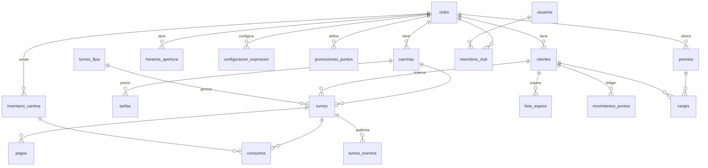
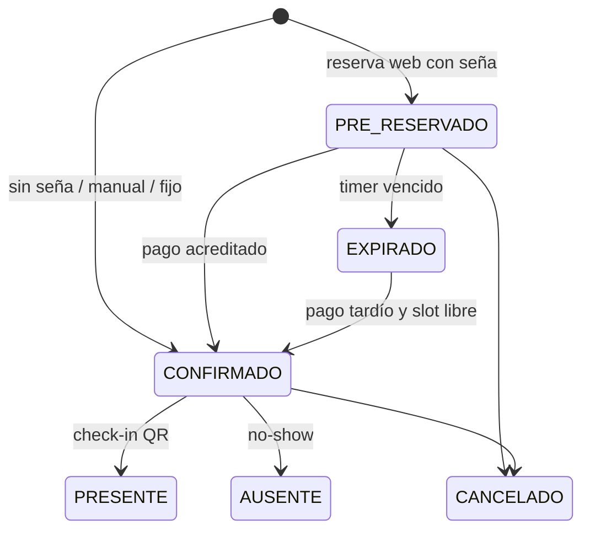

# Canchería — Arquitectura base

> Esquema completo: [`db/schema.sql`](../db/schema.sql) · Prueba de concurrencia: [`db/tests/concurrencia.sh`](../db/tests/concurrencia.sh)

## 1. Stack tecnológico

| Capa | Elección | Por qué |
|---|---|---|
| Lenguaje | **TypeScript** end-to-end | Un solo lenguaje; los esquemas Zod se comparten entre front y API (mismas validaciones en ambos lados). |
| Frontend | **Next.js 15** (App Router) + **Tailwind** + **shadcn/ui** + **TanStack Query** | SSR para la página pública `/{slug}` (carga rápida en 4G y vista previa al compartir por WhatsApp). El panel admin es una PWA instalable en la tablet de recepción. |
| API | **Fastify 5** sobre Node 22 | Uno de los frameworks HTTP más rápidos de Node, con validación por esquema y bajo overhead. Para este dominio la concurrencia la resuelve Postgres, no los hilos de la app; por eso Go o Rust no aportan una ventaja real acá. |
| ORM / SQL | **Drizzle ORM** | SQL-first, sin binario ni motor aparte. Permite SQL crudo tipado para lo que importa (`EXCLUDE`, `FOR UPDATE SKIP LOCKED`, rangos). |
| Base de datos | **PostgreSQL 16** | Tipos de rango + *exclusion constraints*: la anti-sobrerreserva queda garantizada por el motor. También transacciones ACID, `LISTEN/NOTIFY` y JSONB. |
| Jobs / cron | **pg-boss** (cola sobre Postgres) | Timers de expiración, envío de notificaciones, materialización de turnos fijos. Sin Redis al principio: un componente menos para operar. |
| Tiempo real | `LISTEN/NOTIFY` → API → **SSE** | El trigger de `turnos` emite un evento solo si la transacción hace COMMIT; el navegador refresca la grilla. Si después se escala a muchas instancias, se cambia por Redis pub/sub sin tocar el front. |
| Pagos | **Mercado Pago Checkout Pro** + webhooks | Transferencias: comprobante subido a **Cloudflare R2** (S3) y revisado por el admin. |
| Notificaciones | **WhatsApp Cloud API** (Meta, mensajes con plantilla); SMS de respaldo (Twilio) | Despachadas desde una tabla *outbox* con reintentos. |
| QR | `qrcode` (generación) · `BarcodeDetector` / `@zxing/browser` (escaneo con la cámara) | |
| Auth admin | **Better Auth** (sesiones con cookie httpOnly, roles por club) | Los clientes no tienen cuenta. |
| Infra | Docker · API + worker en Fly.io/Railway · web en Vercel · Postgres gestionado (Neon/Supabase/RDS) | Logs con pino + Sentry + OpenTelemetry. |

### Estructura del monorepo (pnpm + Turborepo)

```
apps/
  web/        Next.js — público (/[slug]) + admin (/admin)
  api/        Fastify — REST + SSE + webhooks
  worker/     pg-boss — expiraciones, outbox, turnos fijos, lista de espera
packages/
  db/         esquema Drizzle, migraciones, cliente
  core/       dominio puro: reglas de precio, seña, expiración, puntos (testeable sin DB)
  shared/     esquemas Zod + tipos compartidos front/back
```

Dentro de `api/` se organiza por **módulo de dominio** (`reservas/`, `canchas/`, `pagos/`, `checkin/`, `fidelizacion/`, `cantina/`, `reportes/`), cada uno con `routes → service → repository`.

## 2. Modelo de datos



Decisiones clave:

- **Multi-tenant por `club_id`** en cada tabla. Las FK compuestas `(club_id, cancha_id)` y `(club_id, cliente_id)` impiden que un turno mezcle una cancha de un club con un cliente de otro. Más adelante se puede sumar Row-Level Security.
- **`turnos.rango`** es una columna `tstzrange` generada a partir de `inicio`/`fin` (`[)`, así 20–21 y 21–22 no chocan).
- **Importes congelados** en el turno (`precio_total`, `monto_sena`) y en los consumos (`precio_unitario`): si cambia la tarifa, las reservas ya hechas no se alteran.
- **Puntos como ledger** (`movimientos_puntos`, solo inserciones). `clientes.saldo_puntos` es una caché con `CHECK >= 0`. Un índice único parcial garantiza que un partido acumule puntos una sola vez.
- **Outbox** (`notificaciones`): se escribe en la misma transacción que el cambio de negocio, así nunca se avisa de algo que hizo rollback ni se pierde un aviso.
- **`codigo_checkin`** de 128 bits aleatorios (no el id). El QR contiene `https://…/c/{codigo}` firmado con HMAC; el escáner del admin lo valida.

### Máquina de estados del turno



Estados que **ocupan** la cancha: `PRE_RESERVADO`, `CONFIRMADO`, `PRESENTE`, `AUSENTE`.

## 3. Control de concurrencia

### Capa 1 — La base de datos es la que decide (garantía dura)

```sql
CONSTRAINT turnos_sin_solapamiento EXCLUDE USING gist (
  cancha_id WITH =,
  rango     WITH &&
) WHERE (estado IN ('PRE_RESERVADO','CONFIRMADO','PRESENTE','AUSENTE'))
```

Postgres valida la constraint de forma atómica con el índice: si dos transacciones insertan turnos solapados en la misma cancha en el mismo milisegundo, la segunda espera a que termine la primera y, si esta hace COMMIT, falla con `23P01`. No hay ventana de carrera, no hace falta ningún lock en la app, y se cumple aunque haya N instancias de la API, un bug en el código o un `INSERT` manual.

**Verificado:** `db/tests/concurrencia.sh` lanza 50 conexiones simultáneas por el mismo horario → **1 éxito, 49 rechazos por `turnos_sin_solapamiento`**, y un solo turno vivo.

> ¿Por qué no un "SELECT para ver si está libre y después INSERT"? Porque entre el SELECT y el INSERT otra transacción puede colarse (*check-then-act*). Con `SELECT … FOR UPDATE` sobre la fila de la cancha también funciona (lock pesimista), pero serializa todas las reservas de esa cancha. La exclusion constraint solo hace esperar a quien realmente compite por el mismo rango.

### Capa 2 — Transacción corta de reserva

```ts
// apps/api/src/reservas/reservas.service.ts (esqueleto)
async function crearReserva(input: CrearReservaInput) {
  const cfg   = await resolverConfigExpiracion(input);   // §4
  const precio = await resolverTarifa(input);
  try {
    return await db.transaction(async (tx) => {
      await tx.execute(sql`SET LOCAL app.actor = 'cliente'`);
      const cliente = await upsertCliente(tx, input.cliente);   // por teléfono/DNI
      // expiración perezosa: libera holds vencidos que pisan el rango pedido
      await tx.execute(sql`
        UPDATE turnos SET estado = 'EXPIRADO', expira_en = NULL
         WHERE cancha_id = ${input.canchaId} AND estado = 'PRE_RESERVADO'
           AND expira_en <= now() AND rango && tstzrange(${input.inicio}, ${input.fin}, '[)')`);
      return await tx.insert(turnos).values({
        ..., estado: cfg.requiereSena ? 'PRE_RESERVADO' : 'CONFIRMADO',
        expiraEn: cfg.requiereSena ? calcularExpiracion(cfg, input.inicio) : null,
        idempotencyKey: input.idempotencyKey,
      }).returning();
    });
  } catch (e) {
    if (pgCode(e) === '23P01') throw new ConflictError('TURNO_OCUPADO');      // → HTTP 409 + horarios alternativos
    if (pgCode(e) === '23505' && esIdempotencia(e)) return buscarPorIdempotencyKey(input);
    throw e;
  }
}
```

La creación de la preferencia de Mercado Pago (llamada HTTP externa) va **después** del COMMIT, nunca dentro de la transacción.

### Capa 3 — Idempotencia

- **Reservas:** el front genera un `idempotency_key` (UUID) por intento. Un doble clic o un reintento de red devuelve la misma reserva (índice único parcial).
- **Webhooks:** `UNIQUE (proveedor, external_id)` en `pagos` hace que la misma notificación de MP no pueda procesarse dos veces.

### Capa 4 — Bloqueo optimista para ediciones del admin

Mover un turno de horario o editarlo: `UPDATE turnos … WHERE id = $1 AND version = $2`. Si afecta 0 filas, otro recepcionista lo modificó y la UI recarga. El trigger incrementa `version` en cada UPDATE.

### Capa 5 — Contadores sin carreras

```sql
UPDATE inventario_cantina SET stock = stock - $n WHERE id = $1 AND stock >= $n;        -- 0 filas = sin stock
UPDATE clientes SET saldo_puntos = saldo_puntos - $c WHERE id = $1 AND saldo_puntos >= $c; -- canje
```

### Lock pesimista solo donde hay "leer y decidir"

El webhook de pago y el check-in hacen `SELECT … FROM turnos WHERE id = $1 FOR UPDATE` antes de transicionar el estado, así un pago y una expiración simultáneos sobre el mismo turno se serializan.

## 4. Timer de expiración de seña

### 4.1 Resolución de la regla

Para un turno (cancha, día, hora de inicio) se buscan las filas activas de `configuracion_expiracion` que matchean (los campos `NULL` actúan como comodín) y se elige con:

```sql
ORDER BY prioridad DESC,
         (cancha_id IS NOT NULL) DESC,
         (dia_semana IS NOT NULL) DESC,
         (hora_desde IS NOT NULL) DESC
LIMIT 1
```

Ejemplo de configuración de un club:

| nombre | día | franja | requiere_sena | seña | minutos |
|---|---|---|---|---|---|
| General | — | — | ✅ | 50 % | 30 |
| Finde | sáb/dom | — | ✅ | 50 % | 10 |
| Siesta sin seña | lun–vie | 13–17 | ❌ | — | — |

La lógica vive en `packages/core` como función pura (`resolverRegla(reglas, turno)`), con tests unitarios. Las reglas del club se cachean en memoria unos segundos.

### 4.2 Cálculo de `expira_en`

```
expira_en = min(now() + minutos_expiracion, inicio_turno - margen_min_antes_inicio)
```

Si el resultado es menor a ~3 minutos desde ahora (turno inminente), la política configurable es: (a) exigir el pago inmediato con un timer mínimo de 3–5 min, o (b) no permitir reservar online ese turno y mostrar "llamá al club".

### 4.3 Tres capas para que un hold vencido nunca bloquee la cancha

1. **Lectura:** la consulta de disponibilidad considera libre un `PRE_RESERVADO` con `expira_en <= now()`. El público ve el turno libre en el mismo segundo en que vence, aunque el worker todavía no haya pasado.
2. **Escritura (expiración perezosa):** la transacción de reserva pasa a `EXPIRADO` los holds vencidos que pisan el rango antes de insertar (ver capa 2). Si dos personas compiten por ese hold vencido, el lock de fila del UPDATE las serializa y la exclusion constraint deja ganar solo a una. *Verificado en el test.*
3. **Worker (pg-boss):** un job programado en `expira_en` para cada hold, más un barrido de respaldo cada 30 s:

   ```sql
   WITH vencidos AS (
     SELECT id FROM turnos
      WHERE estado = 'PRE_RESERVADO' AND expira_en <= now()
      ORDER BY expira_en LIMIT 500
      FOR UPDATE SKIP LOCKED          -- varias instancias del worker sin pisarse
   )
   UPDATE turnos t SET estado = 'EXPIRADO', expira_en = NULL
     FROM vencidos v WHERE t.id = v.id
   RETURNING t.id, t.club_id, t.cancha_id, t.inicio, t.fin;
   ```

   El worker se encarga de los **efectos secundarios**: avisar al cliente ("tu reserva venció"), disparar la lista de espera y emitir el evento de tiempo real. Las capas 1 y 2 hacen que la corrección **no dependa** de que el worker sea puntual.

### 4.4 Pagos y el timer

- **Mercado Pago:** la preferencia se crea con `external_reference = turno.id`, `expires = true` y `expiration_date_to = expira_en`, así MP no acepta pagos fuera de término.
- **Webhook:** nunca se confía en el payload. Se consulta `GET /v1/payments/{id}` a MP, se valida monto y referencia, y en una transacción:
  1. `INSERT INTO pagos … ON CONFLICT (proveedor, external_id) DO NOTHING` (idempotente).
  2. `SELECT … FROM turnos WHERE id = $ref FOR UPDATE`.
  3. Si está `PRE_RESERVADO` → `CONFIRMADO`.
  4. Si ya está `EXPIRADO` (el pago llegó en el límite) → intentar `UPDATE … SET estado = 'CONFIRMADO'` dentro de un SAVEPOINT: si el slot sigue libre, se confirma; si da `23P01` (alguien lo tomó) → se encola un **reembolso automático** y se notifica. *Ambos caminos verificados en el test.*
- **Transferencia:** al subir el comprobante, el pago pasa a `EN_REVISION` y `expira_en` se extiende (configurable, ej. +60 min) para que el admin alcance a revisarlo. Aprobarlo = mismo camino que el webhook.

### 4.5 Lista de espera al liberarse un turno

Cuando un turno pasa a `CANCELADO` o `EXPIRADO`, el worker busca la primera inscripción `ACTIVA` compatible (FIFO por `creado_en`, rango que contenga el turno, misma cancha o mismo tipo). Para esa persona crea un **hold `PRE_RESERVADO` propio** (que queda en `lista_espera.oferta_turno_id`) con su timer y le manda por WhatsApp el link de pago. Si vence, se pasa al siguiente. Como el hold ocupa la cancha, nadie del público se la "roba" mientras la persona de la lista decide.

## 5. Otros procesos del worker

| Job | Frecuencia | Qué hace |
|---|---|---|
| `expirar-holds` | job por hold + barrido cada 30 s | §4.3 |
| `despachar-notificaciones` | continuo | Toma la outbox con `FOR UPDATE SKIP LOCKED` y reintenta con backoff exponencial. |
| `materializar-turnos-fijos` | diario | Inserta turnos `CONFIRMADO/FIJO` hasta 8 semanas adelante. Si da `23P01` contra una reserva existente, se lo informa al admin en vez de pisarla. |
| `marcar-ausentes` | cada 15 min | `CONFIRMADO` con `fin + tolerancia < now()` y sin check-in → `AUSENTE` (alimenta la métrica de ausentismo). |
| `recordatorios` | cada 15 min | WhatsApp X horas antes del partido con link para cancelar. |

## 6. Próximos pasos sugeridos

1. Scaffolding del monorepo + `packages/db` (Drizzle sobre este esquema) + Docker Compose con Postgres.
2. Módulo público de disponibilidad y reserva (grilla + endpoint transaccional + SSE).
3. Pagos (Mercado Pago + transferencia) y worker de expiración.
4. Panel admin: agenda, carga manual, check-in QR.
5. Turnos fijos, lista de espera, cantina, fidelización, reportes.
